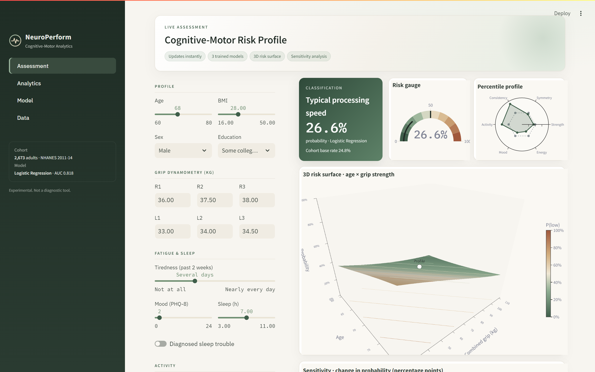
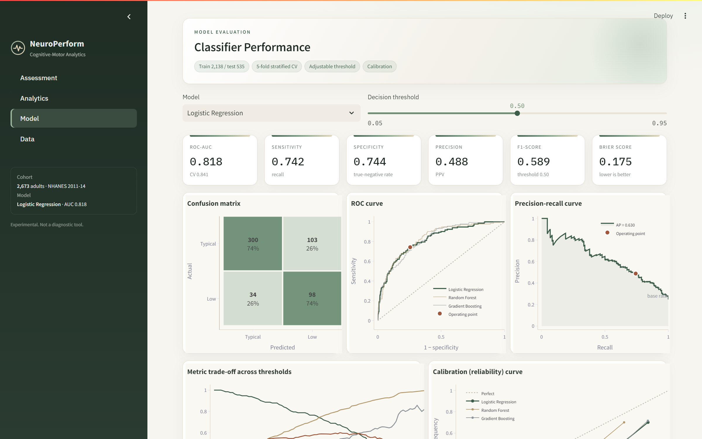
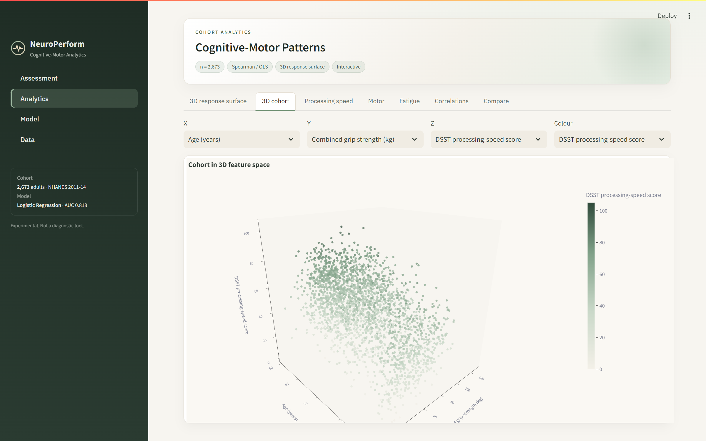

# NeuroPerform

**A Data-Driven Framework for Cognitive-Motor Performance and Fatigue Pattern Analysis**


NeuroPerform quantifies the relationship between psychomotor processing speed, neuromuscular force output and fatigue.
It uses public data from the U.S. National Health and Nutrition Examination Survey (CDC, NHANES 2011–2014;
n = 2,673 adults aged 60–80). The pipeline engineers motor-function features from repeated hand-grip trials, relates
them to cognitive performance through statistical analysis, and trains machine-learning models to predict low
processing speed. Results are delivered through an interactive Streamlit dashboard.



## Features

- **Automated data pipeline.** Downloads the raw CDC files, merges seven survey components and cleans non-response codes.
- **Motor feature engineering.** Computes combined grip strength, bilateral asymmetry, trial-to-trial variability, repeated-effort force change and grip/BMI.
- **Statistical analysis.** Spearman correlation, covariate-adjusted OLS regression, Mann–Whitney U, Kruskal–Wallis and Friedman tests.
- **Machine learning.** Logistic Regression, Random Forest and Gradient Boosting, evaluated with stratified 5-fold cross-validation, permutation importance and a feature-set ablation.
- **Live assessment.** Predictions update instantly as inputs change. The page shows a 3D risk surface, a percentile profile and a sensitivity analysis.
- **Model evaluation.** An adjustable decision threshold drives the confusion matrix, ROC and precision-recall curves, and a calibration curve with the Brier score.

## Results

| Model | CV ROC-AUC | Test ROC-AUC | Recall | F1 |
|---|---|---|---|---|
| **Logistic Regression** | **0.841 ± 0.013** | 0.818 | 0.742 | 0.589 |
| Random Forest | 0.832 ± 0.014 | 0.829 | 0.667 | 0.599 |
| Gradient Boosting | 0.829 ± 0.017 | 0.821 | 0.644 | 0.561 |

Grip strength was independently associated with processing speed after adjustment for age, sex, education and BMI
(β = 2.96 DSST points per SD, 95% CI 2.17–3.75, p < 0.001). Adding motor features to demographic predictors raised
cross-validated ROC-AUC from 0.824 to 0.835.





## Installation

```bash
git clone https://github.com/<Somiyakhan10>/NeuroPerform.git
cd NeuroPerform
pip install -r requirements.txt
```

## Usage

```bash
streamlit run app.py          # launch the dashboard at http://localhost:8501
python src/pipeline.py        # rebuild data, models and results from the CDC source
python tests/verify_outputs.py
python tests/test_dashboard.py
```

The notebook `NeuroPerform_Colab.ipynb` runs the complete pipeline in Google Colab (**Runtime → Run all**).

```

## Data

Centers for Disease Control and Prevention, National Center for Health Statistics. *National Health and Nutrition
Examination Survey Data*, 2011–2014. Public domain. https://wwwn.cdc.gov/nchs/nhanes/ · Details in
[docs/DATA_SOURCES.md](docs/DATA_SOURCES.md).

## Limitations

The cohort comprises older community-dwelling adults rather than athletes. NHANES includes no simple reaction-time
task, and fatigue is self-reported. The framework is designed to transfer to athletic populations with reaction-time,
balance and concussion data.


